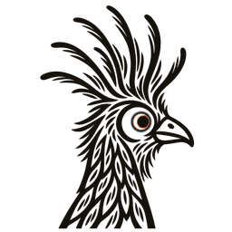

<p align="center">
  <picture>
    <source media="(prefers-color-scheme: dark)" srcset="frontend/public/brand/hoatzin-dark-256.webp" />
    
  </picture>
</p>

<h1 align="center">Skynet</h1>

<p align="center"><b>Optimize Anything.</b> Give Skynet a prompt, code, a DSPy program or any text, plus a set of cases and a metric. Skynet finds a better version and shows you the score that proves it.</p>

<p align="center">
  <a href="https://skynetml.com">skynetml.com</a> ·
  <a href="https://skynetml.com/docs">Docs</a> ·
  <a href="https://skynetml.com/docs/quickstart">Quickstart</a> ·
  <a href="https://skynetml.com/docs/api">API</a> ·
  <a href="LICENSE"></a>
</p>

## How it works

You write two functions: `run(artifact, input)` and `score(input, output, expected)`. Skynet proposes new versions, runs each one on your cases in a sandbox and scores it with your metric. At the end you get the best version and its held-out score next to the score of the version you started with.

## Features

- Engines: GEPA, Best-of-N, Meta-Harness, AutoResearch, AutoSaddler and ShinkaEvolve for prompts, code and text, and DSPy GEPA, MIPROv2 and BootstrapFewShot for DSPy programs. Auto picks one for you. [Engines](https://skynetml.com/docs/concepts/engines)
- Your code runs in an isolated sandbox. Each run has a spending limit, and Skynet reserves it before any paid work starts. [Billing](https://skynetml.com/docs/concepts/billing) · [Security](https://skynetml.com/docs/security)
- Claude, Codex and other MCP clients can check, start, follow and stop runs through the hosted MCP server (`https://mcp.skynetml.com/mcp`, OAuth 2.1). The [Skynet plugin](plugins/skynet) adds skills for Claude and Codex. [MCP](https://skynetml.com/docs/mcp)
- Skynet for Mac runs the whole stack on your Mac. Model calls go through Claude Code or Codex, so your existing CLI plan pays for them. [Mac app](https://skynetml.com/docs/guides/mac-app) · [desktop/](desktop)
- The agent panel sets up runs, reads files you attach and explains results. [Agent panel](https://skynetml.com/docs/guides/agent-panel)
- You can edit datasets in place. The tagger learns your labels, then tags the rest in rounds you review. [Datasets](https://skynetml.com/docs/guides/datasets) · [Tagger](https://skynetml.com/docs/guides/tagger)
- Compare versions, share a run and export the best artifact. [Results](https://skynetml.com/docs/guides/results)
- Pay from a prepaid balance, or bring your own OpenRouter key and pay only the platform fee and sandbox usage.
- The app is in 24 languages and Hebrew is the base locale, so RTL layouts get tested first. The docs are in 17 languages.

## Run it locally

You need Python 3.11, Node 20+, PostgreSQL 15+, Docker, [`just`](https://github.com/casey/just) and [`uv`](https://github.com/astral-sh/uv).

```bash
git clone https://github.com/Skynet-ml/skynet.git && cd skynet
just setup      # installs deps, writes env files with fresh secrets, runs migrations
just dev        # API on :8000, web app on :3000
```

If you use Claude Code, `just install-agent` runs the same setup and fixes known problems as it goes. Open http://localhost:3000. The API reference is at http://localhost:8000/scalar. Run `just --list` for all recipes.

## Repository

```
frontend/   Next.js web app and the public docs (/docs)
backend/    FastAPI API, job workers, engines, MCP server
desktop/    Skynet for Mac (Electron)
plugins/    Skynet plugin for Claude and Codex
i18n/       UI catalogs (Hebrew base + 23 locales)
infra/      Terraform for AWS staging and production
```

## Contributing

Read [CONTRIBUTING.md](CONTRIBUTING.md) for setup, tests and i18n rules. [MAINTENANCE.md](MAINTENANCE.md) says what support to expect. Report vulnerabilities through [SECURITY.md](SECURITY.md).

## Citations

If you use these methods through Skynet in research, cite the original work.

- Lakshya A Agrawal et al. *GEPA: Reflective Prompt Evolution Can Outperform Reinforcement Learning.* 2025. [arXiv:2507.19457](https://arxiv.org/abs/2507.19457)
- Yoonho Lee et al. *Meta-Harness: End-to-End Optimization of Model Harnesses.* 2026. [arXiv:2603.28052](https://arxiv.org/abs/2603.28052)

## License

Skynet is licensed under [AGPL-3.0](LICENSE). If you run a modified Skynet as a service, you must publish your changes.
